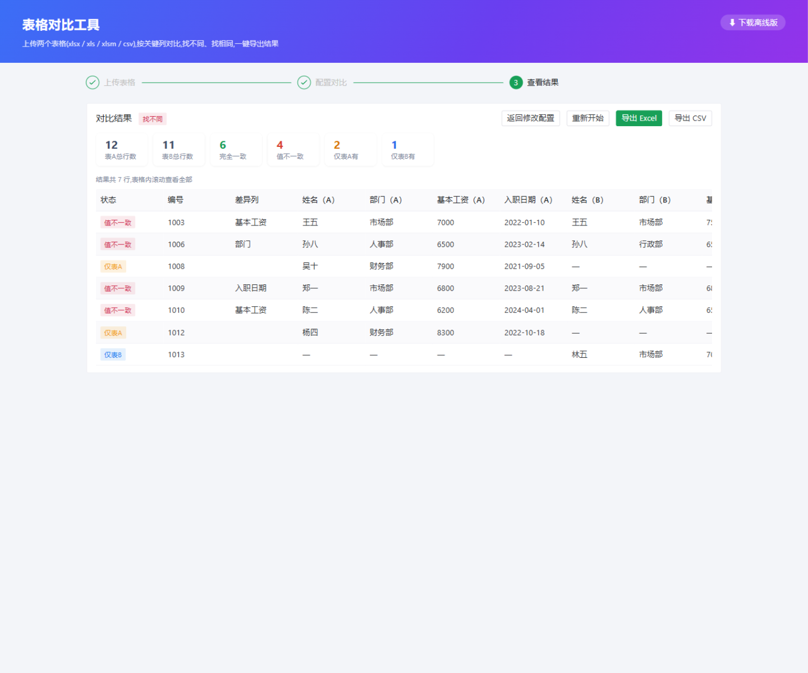

# 表格对比工具

上传两个表格(xlsx / xlsm / xls / csv,可任意混合),选择工作表与关键列,按 **找不同 / 找相同** 两种模式对比,结果生成新表格并导出(xlsx 带差异高亮 / csv)。

**在线体验**:http://excel.ivf-home.xyz

| 上传与预览 | 对比结果 |
| --- | --- |
|  |  |

一套代码,两种发布形态,共用同一套 Python 业务层(`server/app/services/ops.py`):

- **线上版**:Python(FastAPI)+ Vue3 前端,浏览器经 HTTP 接口(`/api/*`)访问
- **离线版**:PyInstaller 单文件 exe + pywebview 桌面窗口。**不运行任何 HTTP 服务**:前端打成单文件 HTML 以 `file://` 加载,页面通过 `window.pywebview.api.*` 直接调用 Python 函数(文件经 base64 传输,导出走原生另存为对话框),全程零 socket、完全断网可用

## 目录结构

```
excel_tools/
├── server/               # Python 后端(FastAPI)
│   ├── app/
│   │   ├── main.py       # 入口:API + 托管前端静态资源
│   │   ├── schemas.py    # 请求/响应模型
│   │   ├── storage.py    # 上传文件临时存储
│   │   ├── routers/      # /api/upload、/api/compare、/api/export
│   │   └── services/     # 表格读取(xls/xlsx/csv)、对比引擎、导出
│   ├── tests/            # pytest 单元测试
│   ├── requirements.txt  # 线上运行依赖
│   └── requirements-dev.txt  # 开发 + 离线打包依赖
├── web/                  # Vue3 + Vite + TS + Naive UI 前端
├── client/               # 离线版:pywebview 启动器 + 三平台打包脚本
└── .github/workflows/    # 三平台离线包 CI 构建(推送到 GitHub 后可用)
```

## 环境准备(conda)

```bash
conda create -y -n excel_tools python=3.12
conda activate excel_tools
pip install -r server/requirements.txt -r server/requirements-dev.txt
cd web && npm install
```

## 开发调试

```bash
# 终端 1:启动后端(127.0.0.1:8000,自动热重载)
conda activate excel_tools
cd server && python run.py

# 终端 2:启动前端(127.0.0.1:5173,/api 自动代理到 8000)
cd web && npm run dev
```

访问 http://localhost:5173 。后端 API 文档:http://localhost:8000/docs

## 线上部署

详细的 Linux 宝塔面板部署步骤(含 Nginx 反代、上传限制、常驻运行)见 [DEPLOY.md](DEPLOY.md),最简形式:

```bash
cd web && npm run build          # 产出 web/dist
cd ../server && python -m uvicorn app.main:app --host 0.0.0.0 --port 8000
```

`app.main` 启动时检测到 `web/dist` 会自动托管,单端口同时提供 API 与页面(也可用环境变量 `EXCEL_TOOLS_STATIC_DIR` 指定静态目录)。

## 离线版打包(三平台)

PyInstaller 不支持交叉编译,各平台的包在对应系统上执行同一脚本:

```bash
conda activate excel_tools
python client/build_offline.py
# 产物:server/downloads/excel-compare-<版本>-<平台>-<架构>.exe|.tar.gz(+ .sha256 校验文件)
# Windows 直接放 exe;macOS / Linux 为 tar.gz(保留可执行位,解压即用)
```

没有三台机器时,推送到 GitHub 后用 [.github/workflows/build-offline.yml](.github/workflows/build-offline.yml) 的 CI 矩阵(Windows / macOS / Ubuntu)构建,在 Actions 页面下载 artifact。Linux 构建需先 `pip install "pywebview[gtk]"` 并安装 GTK / WebKit2GTK 系统库(CI 中已配置)。

流程:构建单文件前端(`npm run build:offline`,JS/CSS 全部内联进一个 index.html)→ 拷贝到 `client/webapp` → PyInstaller 打包 → 产物与 .sha256 进 `server/downloads/`。前端全部使用系统字体与本地打包资源,无任何 CDN 依赖;Windows 使用系统自带 Edge WebView2(Win10/11 一般已内置),Linux 依赖 webkit2gtk 运行库,macOS 包未签名(首次启动右键 → 打开)。源码调试离线版:`python client/launcher.py`(需先执行过 `npm run build:offline`)。

## 页面下载入口

线上版页面右上角有"下载离线版"入口,列出 `server/downloads/` 里的各平台安装包(数据来自 `GET /api/downloads`,文件本体走 `/downloads/` 静态路径),暂无安装包的平台显示"敬请期待";离线客户端内不显示该入口。部署时把 `server/downloads/` 随后端一起发布即可,也可用环境变量 `EXCEL_TOOLS_DOWNLOADS_DIR` 指定其他目录。

下载量按平台累计记录在 `<下载目录>/.stats.json`(每次成功下载安装包 +1,校验文件与列表刷新不计;版本升级不清零),清单接口返回 `downloads` 字段并在入口中展示"已下载 N 次"。

## 对比规则

- 上传后按文件解析出工作表与列,并展示**带行号的原始内容预览**;若表头不在第一行(如顶部有标题/说明行),在"表头所在行"填对应行数,该行之上的内容会被忽略,列与数据按该行重新解析
- **合并表头自动识别**:所选表头行若落在合并区域内,自动把整条表头带(可跨多行/多列)纳入表头——纵向合并取合并单元格的值,横向合并把值铺到覆盖的每一列,多行表头按"上级-下级"拼接列名(如"基本信息-姓名");两个表的表头行数不一致(一个 2 行、一个 3 行)也能各自正确解析、列名对应;选表头带中任意一行结果都一致
- 空表头单元格按列位置命名为"未命名N"(不再出现 pandas 的 `Unnamed: N`);表头带下方的整行空行会被剔除
- 名字对不上、只在一侧存在的列**不会悄悄从结果里消失**:页面顶部给出提示,导出的 xlsx 中"未对比的列"页会列出它们
- 在表 A、表 B 各选 1 个或多个**关键列**(按选择顺序一一对应),用于匹配行
- 重复关键值按出现顺序配对(第 1 个对第 1 个……),配不上的算"仅单侧"
- 值比较基于规范化文本:去首尾空白、空值视为 ""、`1.0` 与 `1` 视为相同
- **对比公式**(可选):默认只比单元格计算结果(缓存值)、不比公式;开启后公式文本不同(即使计算结果相同)也计为差异,差异列标记「[公式]」并展示新旧公式。系统导出、程序生成等**无缓存值**的文件建议开启,否则公式单元格会按空值参与对比(找不同/找相同模式;坐标对比模式始终同时比值与公式)
- **找不同**:输出 仅表A有 / 仅表B有 / 值不一致(标注差异列,导出时差异单元格标红)
- **找相同**:输出两边都有且所有比较列一致的行
- **坐标对比**:不依赖关键列,按单元格坐标逐格比较**值与公式**(xlsx/xlsm),适合无编号的表(值班表/矩阵);输出按行聚合,每行标注差异格的 Excel 坐标与新旧值,公式文本变化(计算结果不变)也会报出;表中部插行/删行会产生连锁差异(与专业 diff 工具行为一致),业务表请优先用「找不同」
- 只在一侧存在的工作表会在结果页给出提示(工作表增删一目了然)
- 不选"参与比较的列"时默认比较全部共有列(不含关键列)
- 文件类型按**内容**识别(zip / OLE2 / 文本),扩展名误存或改名的文件也能正确读取

## 已知边界(v1)

- 上传文件存于系统临时目录 `%TEMP%/excel_tools_uploads`,清理该目录即删除
- 超大文件(几十万行以上)未做流式分块,建议先拆分

## 开源协议

[MIT](LICENSE) — 可自由使用、修改与分发,欢迎 Issue / PR。
